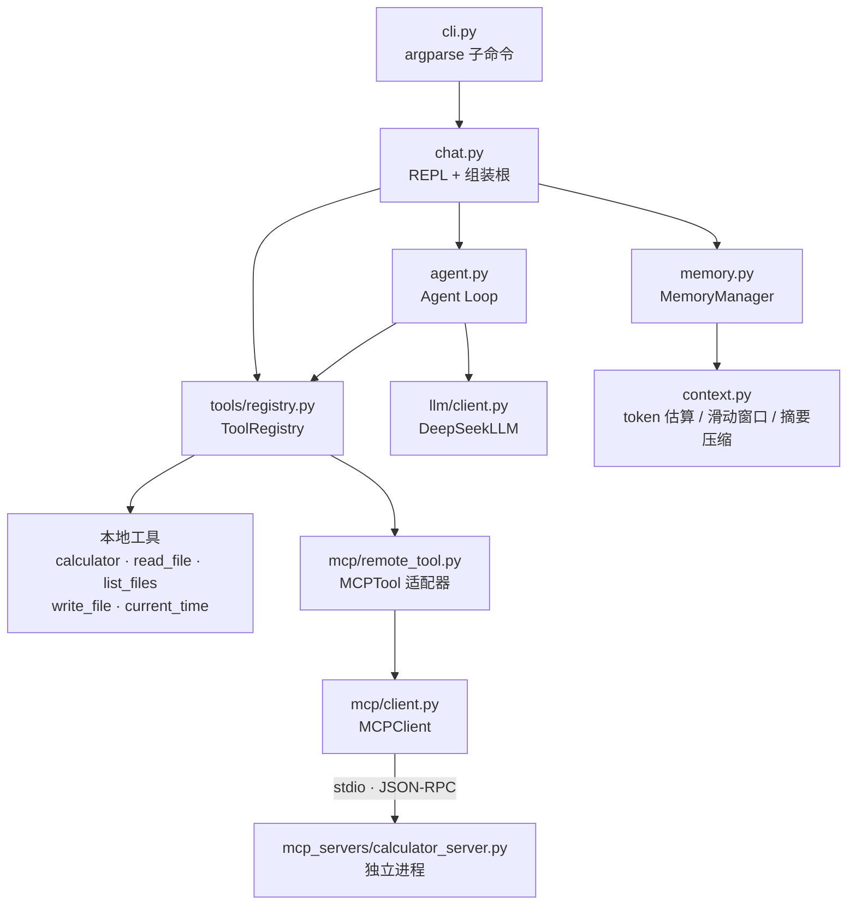

# mini-agent
从零手写的轻量级 AI Agent 框架：LLM 抽象、工具系统、Agent Loop、记忆管理、MCP 协议、流式 CLI。
`Python 3.12+` · `httpx` · 不依赖 LangChain / LlamaIndex 等框架
## ✨ 功能特性

- **LLM 抽象层**：`BaseLLM` 接口 + DeepSeek 实现（流式 / 非流式双路径）
- **工具系统**：`Tool` 基类 + 注册表，schema 与实现绑定、启动时校验（防拼写错误）
- **Agent Loop**：LLM 自主决策 → 工具执行 → 结果回填 → 循环至收敛（最大轮次保护 + 错误容错）
- **记忆管理**：token 油表 → 滑动窗口 → 滚动摘要，context 预算全程可控
- **MCP 协议**：手写 JSON-RPC over stdio 的客户端与服务器；工具发现、适配器接入、断线自愈
- **流式 CLI**：打字机输出、实时工具提示、交互命令（`/help` `/stats` `/tools` `/clear`）
- **网络韧性**：指数退避重试、流式重试边界、失败回滚、启动降级
- **安全边界**：工作区限制、写入审批（human-in-the-loop）

## 🏗️ 架构



## 🚀 快速开始

```bash
git clone <repo-url>
cd mini-agent
python -m venv .venv
.venv\Scripts\Activate.ps1        # Windows；macOS/Linux 用 source .venv/bin/activate
pip install -e ".[dev]"
```

创建 `.env`：

```ini
DEEPSEEK_API_KEY=你的密钥
```

启动：

```powershell
mini-agent chat
```

交互示例：

```text
用户: 帮我算 123*456，然后告诉我现在几点
  [调用工具] calculator 参数: {"a": 123, "b": 456, "operation": "multiply"}
  [calculator-server pid=23416] tools/call calculator ...
  [调用工具] get_current_time 参数: {}
agent:123 × 456 = 56,088，现在是 2026-10-20 21:30:00。
  [context ≈ 812 / 750000 token（0.1%） | 存储 1934 token | 压缩 0 次]
```

## 🧰 命令行

| 命令 | 说明 |
|---|---|
| `mini-agent chat` | 启动交互式对话（挂载 MCP 服务器） |
| `mini-agent chat --no-mcp` | 降级模式：只用本地工具 |
| `mini-agent chat --budget 4000` | 自定义 context 预算（token） |
| `mini-agent --version` | 查看版本 |
| `/help` `/stats` `/tools` `/clear` | REPL 内命令 |

## 🧪 测试

```bash
python -m pytest -v
```

核心回归覆盖：工具系统 / 记忆管理 / Agent Loop / MCP 协议 / CLI。

## 📁 项目结构

```text
mini-agent/
├── src/mini_agent/
│   ├── cli.py            # 命令行入口（argparse）
│   ├── chat.py           # REPL / 组装根
│   ├── agent.py          # Agent Loop
│   ├── context.py        # token 估算 / 滑动窗口 / 摘要压缩
│   ├── memory.py         # MemoryManager
│   ├── llm/              # BaseLLM + DeepSeekLLM（流式/重试）
│   ├── tools/            # Tool 基类 + 5 个工具 + Registry
│   └── mcp/              # MCPClient + MCPTool 适配器
├── mcp_servers/          # 独立进程的 MCP 服务器
├── tests/                # pytest 套件（experiments/ 为学习期脚本归档）
└── docs/                 # 目标 / 路线 / 周计划 / 开发日志
```

## 🧠 关键设计

- **消息协议**：`user → assistant(tool_calls) → tool(result) → assistant(final)`
- **视图与存储分离**：完整历史永远保留，每次请求按预算裁剪（system 永驻 + user 边界切分保证工具协议完整）
- **错误即数据**：工具错误回传 LLM 自主处理；连接层错误重试、协议层错误上抛
- **流式重试边界**：已展示内容不重试、工具碎片可重试（无展示、无副作用）

## 📌 版本
